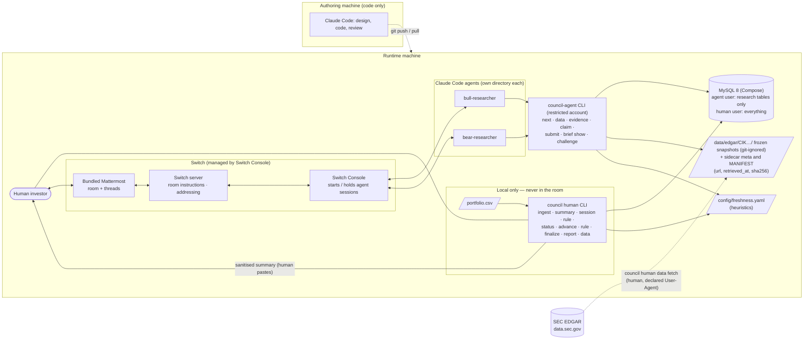

# Investor Council — Architecture

Status: **v0.2, synchronised with the implemented pre-kickoff foundation (Nov 3 2026).** Read with PRD.md, AGENT_DESIGN.md, DATABASE_SCHEMA.md.

Tags: **[Docs: page]** = verified at docs.switchagents.ai (the Switch docs MCP was unavailable; pages were read directly). **[UNVERIFIED — Tn]** = Day-1/2 test in IMPLEMENTATION_PLAN §3. Nothing essential depends on an UNVERIFIED item.

### v0.2 changes
Two agents; human-initiated stages; local CSV processing with a sanitised room summary; "Switch = collaboration and shared-context layer" (not an orchestrator); EDGAR financial-statement snapshots only; honest privacy limits; Day-1 tests for undocumented behaviour.

### Implementation status (Nov 3 2026, before kickoff)

The deterministic foundation and the agent tooling exist and are tested (217 tests; Python 3.13; MySQL 8.0.46).
Connecting Switch Console and running live agents is still pending (it needs Console installed; see `switch/SETUP.md`).
Sections below describe the approved design; components marked **(pending)** are not built yet.

| Component | Status | Where |
|---|---|---|
| `council db init`, `council db status` | **Implemented** | `council/cli/db_cmds.py`, `council/db/` |
| `council human` CLI | **Implemented:** `ingest`, `summary` (`--shared`), `session new` / `show`, `status`, `advance`, `rule`, `finalize`, `report` (`--local-detail`, `--note`, `--save`, `--strict`), `data fetch` / `register` / `inspect` / `manifest`, `agents init` | `council/cli/human.py`, `council/stages.py` |
| `council-agent` / `council agent` CLI and stage validation | **Implemented and tested end to end** against a real MySQL server as the restricted account: `next`, `data list` / `show`, `evidence add` / `list`, `claim add` / `list`, `submit`, `brief show --other`, `challenge add`, `final`, `whoami` | `council/agent/` |
| MySQL schema, migrations, human and agent accounts | **Implemented**, grants tested | `council/db/`, DATABASE_SCHEMA.md |
| Portfolio ingestion, metrics, sanitised summary | **Implemented** | `council/portfolio/` |
| SEC EDGAR adapter (CIK lookup, company facts, filing metadata, cache, validation, fiscal-period identification) | **Implemented, tested on synthetic fixtures only**; never run against live SEC responses (test T11) | `council/edgar/` |
| Evidence storage, verification, claim typing, GAP, freshness and conflict flags | **Implemented** as a library | `council/evidence/` |
| Dossier renderer, advice-language lint | **Implemented** | `council/report/` |
| Instruction texts (`switch/`), agent directory generator (`council human agents init`), setup guide (`switch/SETUP.md`) | **Written**; not yet loaded into a running Switch | `switch/`, `agents/` (generated, git-ignored) |
| Ruling gate (a session cannot be finalized while a flagged claim lacks an accept/reject ruling) | **Implemented and tested** | `council/report/gate.py`, `council/stages.py` |
| Switch Console connected, the room and live agents, Day-1 tests T1 to T10 | **Pending**: Switch Console is not installed on the development machine | |
| Frozen EDGAR dataset (3 to 5 companies) | **Pending** (Day 2) | |

---

## 1. Architecture in one paragraph

A human and two Claude Code agents (Bull, Bear) share one Switch room backed by the bundled Mattermost. The **human** starts each of three stages by posting a message that tags both agents. The agents do their research by calling a small Python CLI (`council agent …`) that reads frozen SEC EDGAR snapshots, verifies evidence and stores typed claims in MySQL. Everything involving the user's raw portfolio is done by a separate command group (`council human …`) run by the human in a terminal: CSV ingestion, deterministic math, a **sanitised summary** that is pasted into the room, rulings, and the final dossier. Switch supplies the shared room context, instructions, addressable agents, the human's ability to interject, and the audit trail. There is no orchestrator service.

## 2. Diagram



## 3. Components and responsibilities

| Component | Responsibility | Does NOT |
|---|---|---|
| **Switch Console** | Registers agents, starts a Claude Code session when an agent is addressed, holds the agent connection, runs the local Switch server and bundled Mattermost [Docs: quickstart, switch-console] | Run when the laptop sleeps or Console is closed — local agents stop answering [Docs: what-keeps-your-agent-running] |
| **Switch room (Mattermost)** | Shared context: conversation, Room Instructions (shown to every agent that joins), human interjection, audit trail [Docs: create-a-room, shared-context] | Enforce what agents decide; hide messages from agents (every agent in a room can read its conversation [Docs: working-safely-with-agents]) |
| **bull-researcher / bear-researcher** | Research from frozen EDGAR data via the agent CLI; file typed claims; post briefs, challenge responses and final positions | See the portfolio DB tables or CSV (by design/grants/convention); trigger each other; give advice |
| **`council human` CLI** | Ingest CSV; math; create sessions; print the sanitised summary; status; advance the stage; record rulings; finalize (the ruling gate); render the dossier; fetch, register and inspect EDGAR snapshots; generate the agent directories | Run inside an agent session |
| **`council-agent` CLI** | Read-only data access to frozen sources; create evidence/claims; submit per stage; show the *other* agent's filed brief once stage ≥ 2 (and only after filing your own); file challenge responses (at most three) and final positions; enforce `stage` checks. Role and account come only from the agent directory's `.council.env` | Read `portfolios`/`holdings`/`dossiers`; advance the stage; write rulings; register sources; load the human's `.env`; request any other account |
| **MySQL 8** | Durable ledger (10 domain tables plus `schema_migrations`; see DATABASE_SCHEMA). Two accounts with different grants (implemented, tested) | Be written to directly by agents (CLI only) |
| **`data/edgar/`** | Local cache of frozen responses (`CIK##########/`) with sidecar metadata and `MANIFEST.json`; git-ignored by default, a chosen dataset is added deliberately with `git add -f` | Update silently: a cached file whose SHA-256 no longer matches its sidecar is refused, and `--refresh` is explicit |
| **`config/freshness.yaml`** | Freshness heuristics | Claim to be an accounting or regulatory standard |

## 4. Stages and data flow

The human controls stages. The agent CLI checks `research_sessions.stage` (1 → 2 → 3). `council human advance` normally requires both agents' submissions for the current stage and offers `--force` (needed for the sequential fallback or after an agent failure).

**Step 0 — local preparation (terminal, outside Switch)**
`council human ingest --file …` → weights, sector exposure, concentration, overlap → MySQL. `council human session new --ticker … --thesis …` → `S-0001`, `stage = 1`, prints the **sanitised summary** (also stored in `research_sessions.shared_summary_json`). Both are implemented.

**Stage 1 — Initial analysis**
Human posts (template in AGENT_DESIGN §6) tagging `@bull @bear` with the summary, ticker, thesis and session id. Each agent: `council agent next S-0001 --as bull` → data index, sanitised summary, allowed commands → `evidence add` / `claim add` / `gap add` → `submit --stage 1` → posts a ≤120-word brief with its claim IDs. Humans see both briefs in the thread.

**Stage 2 — Challenge round**
Human runs `council human status` (both stage-1 submissions present?) and `advance --to 2`, then posts the challenge request tagging both. Each agent: `brief show --other` (works only at stage ≥ 2) → `challenge add` per targeted claim (disputes / partly_agrees / agrees / needs_evidence; must cite evidence or say none found) → `submit --stage 2` → posts a summary in the room.

**Human rulings**
Human reads the room, `council human status` (it lists every unresolved flagged claim with the reasons) and the dossier. For each: `council human rule S-0001 C-X2 reject --note "…"` (implemented). At most one targeted follow-up message to one agent for `needs_evidence`.

**Stage 3 — Final synthesis**
Human `advance --to 3` and posts the synthesis request (each agent files a final position with concessions and what it could not establish, taking the human's rulings into account — rulings are visible via `council agent next`). Then `council human report --session S-0001` (implemented) renders the dossier from the ledger and the human posts it to the room (paste, or attachment if T9 passes) with their own decision note, and `council human finalize S-0001 --note "…"` stores the FINAL dossier.

**Principle:** chat carries discourse and pointers; the ledger carries structured truth. Each stage message includes `[session S-0001]` and agents re-hydrate from `council agent next`, because a session isn't guaranteed to have prior room history [Docs: connectors-and-runtime].

## 5. Handoffs: what Switch documents and what we assume

| Statement | Source |
|---|---|
| An agent acts when someone with permission addresses it with `@name` (or alias); without an `@mention` no agent responds unless follow-ups are on | [Docs: work-in-a-room] |
| "Follow-ups start only from a person's message, never from an agent's." | [Docs: work-in-a-room] |
| The docs do **not** say what happens when an agent mentions another agent | [Docs: work-in-a-room] — not assumed |
| By default every agent in a room receives every message; only the addressed agent acts | [Docs: how-switch-works, life-of-a-message] |
| Several agents can be tagged in one message | [Docs: work-in-a-room] (the vendor-review and meeting-prep use-case pages show it; whether two Claude Code sessions then run concurrently is **[UNVERIFIED — T1]**) |

Design consequences:
1. **Every stage starts with a human message.** The Bull and Bear never need to wake each other.
2. **Always tag both agents explicitly.** With two agents, follow-ups (which route to "the agent that last spoke") would be ambiguous; leave `!follow-ups` off or ignore it.
3. **Parallel by default, sequential as fallback.** Test T1: does one message tagging `@bull @bear` run both sessions at the same time? If not, or if usage limits bite, the human sends the stage message to `@bull`, waits for the brief, then to `@bear`. Fallback consequence: the second agent could read the first's room post before filing; the CLI still blocks reading the other's *filed* brief at stage 1 and the instruction says "file before reading", so independence is reduced but not eliminated. The demo notes this.
4. **Agent→agent mention is an informational test (T8) only**; no feature uses it.
5. **Blind first pass is partly tool-enforced.** Room messages are visible to both agents by default, so independence is protected by: parallel execution, the "file before reading" instruction, and the CLI refusing `brief show --other` until stage 2. This is a limitation, not a guarantee.

## 6. Switch features used

| Feature | Use | Source |
|---|---|---|
| Room + Room Instructions | The protocol and rules, read by every agent that joins | [Docs: create-a-room, shared-context] |
| Agent instructions | Per-agent role contract, sent every session | [Docs: agent-settings] |
| `@mention` by the human | Stage triggers | [Docs: work-in-a-room] |
| `!set-alias @agent @alias`, `!invite-agent`, `!list-agents`, `!agents-status` | Setup and pre-demo health check | [Docs: room-commands] |
| `!interrupt @agent`, `!reset @agent`, `!compact @agent` | Recovery from a stalled or confused session | [Docs: room-commands] |
| Threads | One per research session | [Docs: life-of-a-message] |
| Per-agent Directory / Run location / provider | Separate directories; all "This computer"; Claude Code | [Docs: onboard-your-agents] |
| Ownership + "Who can talk to your agent" | Human is owner; default policy (owner and owner's agents) suffices because only the human instructs agents | [Docs: identity-and-access, agent-settings] |
| Auto mode on, Bypass off; Advanced config (Tools / Disallowed tools / Max turns) | Permission posture; exact tool-allowlist behaviour is **[UNVERIFIED — T3]** | [Docs: agent-settings] |
| Approvals (Allow once / session / Decline) | Owner answers if Auto mode escalates | [Docs: work-in-a-room] |
| Room templates | Possible reproducibility aid; **[UNVERIFIED — T10]**, P2 | [Docs: room-templates] |

**Deliberately unused:** roles, packages/library documents, agent-to-agent mention, `send_targeted_message` (args undocumented), CSV attachments, remote hosts, scheduling (Switch has none).

## 7. Human participation

| Point | Human does | Enforced by |
|---|---|---|
| Local prep | Runs ingest; decides what summary to paste | CSV stays in the terminal |
| Stage 1/2/3 triggers | Posts each stage message | Agents act only when a person addresses them |
| Rulings | Accepts / rejects / asks for evidence per flagged item | `council human rule` records them. **The gate:** a claim is flagged if it is UNVERIFIED, cites non-verified or STALE/CONFLICT evidence, or the other agent disputed it or asked for evidence. A flagged claim is resolved only by `accept` or `reject` (`needs_evidence` is not a resolution). `council human finalize` refuses while any flagged claim is unresolved, with no override; draft dossiers show unresolved claims under "UNRESOLVED" with a banner and never among findings |
| Interjection | Can address either agent at any time | Shared room |
| Decision note | Writes the conclusion in their own words | The template never fills it (the `--note` text is the human's) |

## 8. Privacy design and its limits

**Design.** The raw CSV is processed locally in Python and never posted, attached or put in an agent directory. The room receives only the sanitised summary (default fields in PRD §4). Agent DB credentials grant no access to `portfolios`, `holdings` or `dossiers`.

**Implemented and tested:** the CSV is parsed locally and never copied; the sanitised summary carries rounded percentages, counts, the target ticker and the price date, and no shares, values, cost basis, other tickers or file name; `council human report` is sanitised by default (`--local-detail` adds positions and is meant to stay local) and omits the CSV's content fingerprint in the shareable version; a regression test derives every private value from the holdings and asserts none appears in the shareable summary or dossier (with a control proving the check can detect a leak); the restricted account is refused `SELECT` on the private tables and any `UPDATE`/`DELETE`; the database port is published on `127.0.0.1` only; `.gitignore` excludes `.env*`, `.council.env`, `.switch/`, every CSV except the synthetic sample, local-detail dossiers, dumps and the SEC cache.

**Why not "attach it and trust one agent":** an attachment in a shared room is readable by every room member and agent; "instructions and documents in a room are only available to the people and agents who are room members" [Docs: work-in-a-room] and "every agent in a room can read its conversation, regardless of who is allowed to address it" [Docs: working-safely-with-agents].

**Honest limits.**
- Agents run as the same OS user and "inherit exactly their owner's permissions" [Docs: identity-and-access]; a Claude Code session with shell access could in principle read any file that user can. Database grants and directory separation are **defence-in-depth and convention, not a hard boundary**. Mitigations: keep the CSV and the human DB credentials outside agent directories; agents' only config file holds the restricted DB user; restrict tools if T3 allows; use the synthetic sample for demos; consider a separate OS user.
- Agent processes receive only a fixed set of environment variables [Docs: onboard-your-agents], so credentials for the agent DB user live in a gitignored file in the agent directory (**[UNVERIFIED — T4]** for CLI invocation and PATH).
- The sanitised summary, thesis text and agents' output are visible to all room members, stored in Mattermost, and processed by the model provider through Claude Code. Rounded weights are still personal information; the human chooses what to paste.
- Switch writes agent credentials to `.switch/agents/<name>.json` in each agent directory [Docs: connectors-and-runtime]; `.switch/` and `.env` stay out of git.

## 9. Runtime and two-machine plan

**Run everything locally on the runtime machine** (Python 3.13, Docker, and later Switch Console): Switch Console, bundled Mattermost, MySQL (Compose), both agents. Local agents answer only while Console is running [Docs: what-keeps-your-agent-running]; keep the machine awake during runs. A remote host is a stretch option only [Docs: host-remotely].

| Machine | Role |
|---|---|
| Authoring machine | Claude Code for design, code and review; unit tests only (`pytest -m "not db"`); never runs Switch; pushes to GitHub. If it is employer-managed, confirm you are permitted to use it for this project and keep employer code, data and credentials out of the repository |
| Runtime machine | Docker, MySQL, Switch Console, agents, end-to-end tests; pulls from GitHub; the only machine that holds real or sample portfolio data |

The project requires **Python 3.13** (`requires-python = ">=3.13,<3.14"`); no other version has been tested.

**Concurrency:** two Claude Code sessions (Bull, Bear) are tested in T1; a third is not assumed. **Sequential fallback** is defined in §5.

Layout. Present today:
```
Investor-Council/
  docs/
  council/                 # python package: cli/, db/, portfolio/, edgar/, evidence/, report/
  config/freshness.yaml    # freshness heuristics
  switch/                  # room instructions, agent manual and role texts, SETUP.md (committed)
  agents/                  # generated by `council human agents init`: CLAUDE.md, .council.env, council-agent wrapper (git-ignored)
  samples/portfolio.csv    # synthetic sample portfolio (invented tickers and prices)
  data/edgar/              # local EDGAR cache: CIK##########/{companyfacts,submissions}.json + .meta.json, MANIFEST.json (git-ignored)
  docker-compose.yml       # MySQL only (Switch Console manages Switch's own containers)
  tests/                   # 217 tests; synthetic EDGAR fixtures in tests/synthetic.py
  pyproject.toml           # requires Python >=3.13,<3.14
  .env.example             # every secret blank; the real .env is git-ignored
  .gitignore               # .env*, .council.env, .switch/, every *.csv except the sample, *.local.md, dumps, SEC cache
```
Also present: `switch/` (committed: `room-instructions.md`, `agent-manual.md`, `role-bull.md`, `role-bear.md`,
`SETUP.md`) and `agents/bull-researcher/`, `agents/bear-researcher/` (generated by `council human agents init`, all
git-ignored: a `.council.env` holding only the restricted DB account and the role, a `council-agent` wrapper, and a
`CLAUDE.md` composed from the role text plus the manual; whether Console-launched Claude Code reads `CLAUDE.md` is
UNVERIFIED, test T2). Pending: `scripts/` (health check; reset is currently `docker compose down -v` followed by
`council db init`).

## 10. Market data architecture

- **Source:** SEC EDGAR JSON APIs on `data.sec.gov` (submissions metadata; XBRL company facts); no API key, **max 10 requests/second, declare a User-Agent with identity and contact, no crawling** [Docs: sec.gov EDGAR APIs, fair-access policy]. Snapshots are fetched once by the human (`council human data fetch --cik N`) with a declared User-Agent from their own contact (`COUNCIL_SEC_USER_AGENT`, no default) and cached under `data/edgar/CIK##########/` (git-ignored by default; a deliberately chosen frozen dataset is added with `git add -f`). If that dataset is committed, judges need not call EDGAR.
- **What EDGAR gives us:** filing metadata and XBRL financial-statement facts. The fetched SEC page does not mention stock prices, so **we treat EDGAR as having no price data**. The fact-entry field names we plan to store (period end, value, accession number, fiscal year/period, form, filing date) are **[UNVERIFIED — T11]** until checked against a real response. The adapter has been exercised on synthetic fixtures only; it validates strictly and fails loudly if a real response differs.
- **Source types are separate:** `FINANCIAL_STATEMENT` (XBRL facts), `FILING_TEXT` (P1 excerpts), `PRICE` (reserved; unused in MVP).
- **Prices for portfolio weights** come only from the user's CSV (`price` column; the as-of date is given with `--price-as-of` and stored on the portfolio). The sample CSV is synthetic and labelled. Claims requiring market prices (valuation multiples, returns) are recorded as `GAP`.
- **Provenance:** each `sources` row records URL, CIK, entity name, retrieval timestamp (UTC), SHA-256 and snapshot path (content-addressed); each `evidence_refs` row records the fact's concept, unit, period start/end, fiscal year/period *as reported on the filing*, form, filing date and accession number. A metric missing for a company (tag differs or absent) → `GAP`, never estimated (`council/edgar/metrics.py` maps each metric to candidate XBRL concepts; coverage per company is unverified until T11).
- **Adapter behaviour (implemented):** request rate defaults to 5/s and cannot exceed 10/s; transient server errors are retried; responses are validated before being cached; a cached file that fails its SHA-256 check is refused; annual versus quarterly periods are classified by duration (not by `fp`), cover-page `dei` facts never define a fiscal period, and when the same period is reported with different values in different filings the latest-filed value is selected and the others are kept as a `CONFLICT`.
- **Freshness heuristics** (`config/freshness.yaml`): annual max age (456 days by default), quarterly max age (183), snapshot max age (30). Fact age runs from the period end to the session date; annual-basis facts use the annual limit and everything else the quarterly limit; snapshot age runs from retrieval to the session date. Defaults are application heuristics, shown as such, not accounting or regulatory standards. The session stores the config it used.
- **Frozen, not live:** every output carries `data_mode = FROZEN_SNAPSHOT`, the retrieval date, and "newer filings may exist".
- **Verification scope:** the verifier proves a quoted figure/text exists in the stored snapshot (provenance), not that the source is correct, complete or current.

## 11. Answers to the architectural questions (v0.2)

1. **Handoffs** — human message tagging agents; no task protocol; agent-triggered handoff not assumed (§5).
2. **Room instructions** — "Instructions" field at room creation / Console › room › Configuration; every agent reads them on joining; role contracts go in Agent instructions [Docs: create-a-room, shared-context, agent-settings].
3. **Identity, permissions, directories** — names `[a-z0-9._-]`, unique and immutable; Run location and Directory fixed at creation for Console agents; agents inherit owner permissions; "Who can talk to your agent" default is owner and owner's agents; credentials in `.switch/agents/<name>.json`; advanced config in `.switch/config/<name>.json` [Docs: onboard-your-agents, agent-settings, connectors-and-runtime].
4. **CSV via Switch** — attachments are documented ("attach the file and mention the agent in the same message") but are visible to the room, so the MVP **does not use them**. Behaviour on Mattermost stays an informational test (T7).
5. **Different directories / hosts** — supported per agent [Docs: onboard-your-agents, host-remotely]; MVP: two directories, one host.
6. **Simplest reliable trigger** — one human message per stage. No scheduler exists in Switch.
7. **Indispensability** — see §12.
8. **React UI** — not needed; Mattermost provides threads, identity, markdown rendering and approvals.

## 12. What Switch provides, honestly

Switch is the **collaboration and shared-context layer**; it is not our orchestrator.
- **Shared room context** — both agents and the human see the same thread; Room Instructions brief every agent once.
- **Addressable, independent agent sessions** with their own identities, directories and permissions.
- **Human-in-the-loop by construction** — the human triggers every stage, can interject at any time, and answers approvals.
- **Visible challenge** — each agent's response to the other is a normal room message the human can read and interrupt.
- **Audit trail** — the thread plus ledger records who said what and what the human ruled.

Without Switch we would have to build a multi-agent chat surface, session management, shared context, agent identity/permissions and human interjection.

Weaknesses we accept: the database holds the structured truth, so Switch carries conversation rather than data; human-initiated stages mean the "collaboration" the demo shows is two agents responding to each other's *filed* findings at the human's prompt, not autonomous agent-to-agent negotiation. We state this plainly in the README.
