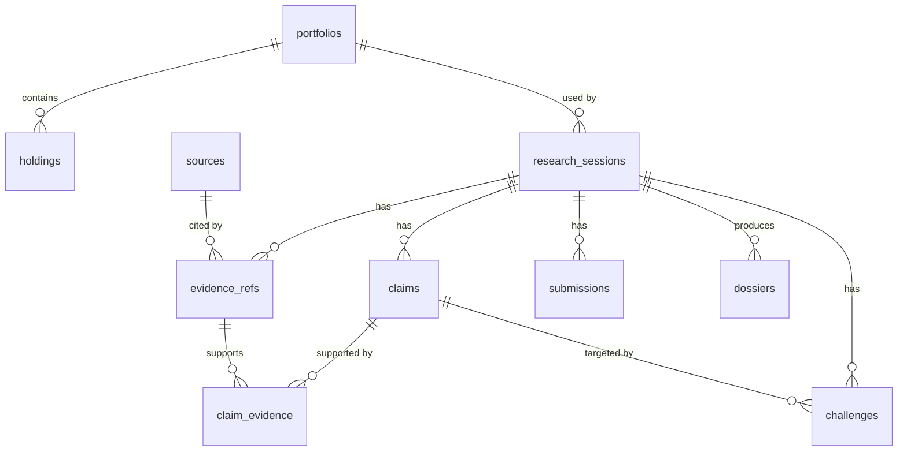

# Investor Council: Database Schema (MySQL 8)

Status: **v0.2, synchronised with the implemented migration `0001_initial` (Nov 3 2026).** The DDL below is
the content of `council/db/migrations/0001_initial.sql`, applied by `council db init`, and was run against
MySQL 8.0.46. The example records in section 5 are executed against a scratch database as part of the
pre-commit check.

Access path: the `council` CLI and library only. Two MySQL accounts: `council_human` (full access to the
`investor_council` database) and `council_agent` (research tables only; no access to `portfolios`, `holdings`
or `dossiers`). The agent tooling that will use the second account is built after kickoff; the account and
its grants already exist and are tested.

### Changes relative to the first v0.2 draft of this document
- DDL is now the real migration, with these additions: `evidence_refs` gained `metric_name`, `taxonomy`,
  `fact_period_start`, `fact_fiscal_year`, `fact_fiscal_period`, `fact_form` and `verification_detail`
  (the draft only had the period end, filing date and accession); `portfolios` gained `excluded_rows` and
  `ingest_warnings`; `research_sessions` gained `target_cik` and `target_sector`; `sources` gained `entity_name`.
- `research_sessions.code` is `VARCHAR(8)`; holdings require `price > 0` (draft: `>= 0`); `CHECK` constraints are named.
- Accounts use host `%`, not `127.0.0.1` (section 3 explains why).
- Migrations are plain versioned SQL with a `schema_migrations` table (no Alembic); `council db init` /
  `council db status` replace the draft's `council human db init`.
- Rulings are rendered, not enforced: `council human report` labels unruled claims instead of refusing (section 4).

Principles: minimal tables; every external fact traceable to a source row with URL, fiscal period, filing
date and retrieval time; no brokerage identifiers, names, emails or credentials; no price data in the MVP;
cost basis is never ingested.

## 1. Relationships



Ten domain tables plus the `schema_migrations` bookkeeping table.
Agent-readable: `research_sessions` (selected columns), `sources`, `evidence_refs`, `claim_evidence`,
`submissions`, `challenges`, and `claims`. Human-only: `portfolios`, `holdings`, `dossiers`, and the ruling
columns of `claims`.

Implementation status: `portfolios`, `holdings`, `research_sessions`, `sources`, `evidence_refs`, `claims`,
`claim_evidence` and `dossiers` are written by implemented code. `submissions` and `challenges` exist (with
their uniqueness constraints) but have no writing commands yet; those belong to the agent tooling built after
kickoff. The dossier renderer already reads `challenges` if rows exist.

## 2. DDL (`council/db/migrations/0001_initial.sql`)

```sql
-- Investor Council schema v0.2 (see docs/DATABASE_SCHEMA.md). 10 tables.
-- Migrations are immutable once applied (checksummed); add 0002_*.sql for changes.
-- CREATE TABLE IF NOT EXISTS keeps a half-applied run (DDL auto-commits in MySQL) re-runnable.

-- ---------- Human-only: the user's portfolio (processed locally) ----------
CREATE TABLE IF NOT EXISTS portfolios (
  id               BIGINT UNSIGNED AUTO_INCREMENT PRIMARY KEY,
  name             VARCHAR(120) NOT NULL,
  origin           ENUM('sample','user') NOT NULL,
  csv_sha256       CHAR(64) NOT NULL,
  base_currency    CHAR(3) NOT NULL DEFAULT 'USD',
  price_as_of      DATE NULL,
  price_source     VARCHAR(120) NOT NULL DEFAULT 'user-supplied (CSV)',
  excluded_rows    INT UNSIGNED NOT NULL DEFAULT 0,
  ingest_warnings  JSON NULL,
  created_at       TIMESTAMP NOT NULL DEFAULT CURRENT_TIMESTAMP,
  UNIQUE KEY uq_portfolio (csv_sha256, origin)
) ENGINE=InnoDB;

CREATE TABLE IF NOT EXISTS holdings (
  id             BIGINT UNSIGNED AUTO_INCREMENT PRIMARY KEY,
  portfolio_id   BIGINT UNSIGNED NOT NULL,
  ticker         VARCHAR(16) NOT NULL,
  shares         DECIMAL(18,6) NOT NULL,
  price          DECIMAL(18,4) NOT NULL,
  sector         VARCHAR(80) NULL,
  sector_source  ENUM('csv','edgar_sic','unclassified') NOT NULL DEFAULT 'unclassified',
  CONSTRAINT fk_hold_portfolio FOREIGN KEY (portfolio_id) REFERENCES portfolios(id) ON DELETE CASCADE,
  UNIQUE KEY uq_hold (portfolio_id, ticker),
  CONSTRAINT chk_hold_shares CHECK (shares > 0),
  CONSTRAINT chk_hold_price CHECK (price > 0)
) ENGINE=InnoDB;

-- ---------- Session ----------
CREATE TABLE IF NOT EXISTS research_sessions (
  id                   BIGINT UNSIGNED AUTO_INCREMENT PRIMARY KEY,
  code                 VARCHAR(8) NOT NULL UNIQUE,
  portfolio_id         BIGINT UNSIGNED NOT NULL,
  target_ticker        VARCHAR(16) NOT NULL,
  target_cik           CHAR(10) NULL,
  target_sector        VARCHAR(80) NULL,
  thesis               TEXT NOT NULL,
  stage                TINYINT UNSIGNED NOT NULL DEFAULT 1,
  status               ENUM('OPEN','FINALIZED','ABORTED') NOT NULL DEFAULT 'OPEN',
  shared_summary_json  JSON NOT NULL,
  data_mode            ENUM('FROZEN_SNAPSHOT') NOT NULL DEFAULT 'FROZEN_SNAPSHOT',
  freshness_cfg_json   JSON NOT NULL,
  session_date         DATE NOT NULL,
  created_at           TIMESTAMP NOT NULL DEFAULT CURRENT_TIMESTAMP,
  updated_at           TIMESTAMP NOT NULL DEFAULT CURRENT_TIMESTAMP ON UPDATE CURRENT_TIMESTAMP,
  CONSTRAINT fk_sess_portfolio FOREIGN KEY (portfolio_id) REFERENCES portfolios(id),
  CONSTRAINT chk_sess_stage CHECK (stage BETWEEN 1 AND 3)
) ENGINE=InnoDB;

-- ---------- Frozen sources (content-addressed: one row per exact snapshot) ----------
CREATE TABLE IF NOT EXISTS sources (
  id               BIGINT UNSIGNED AUTO_INCREMENT PRIMARY KEY,
  source_key       VARCHAR(160) NOT NULL UNIQUE,
  source_type      ENUM('FINANCIAL_STATEMENT','FILING_TEXT','PRICE') NOT NULL,
  source_name      VARCHAR(160) NOT NULL,
  entity_name      VARCHAR(200) NULL,
  url              VARCHAR(1000) NOT NULL,
  cik              CHAR(10) NULL,
  form_type        VARCHAR(16) NULL,
  accession_no     VARCHAR(24) NULL,
  fiscal_year      SMALLINT NULL,
  fiscal_period    VARCHAR(4) NULL,
  period_start     DATE NULL,
  period_end       DATE NULL,
  filed_date       DATE NULL,
  retrieved_at     DATETIME NOT NULL,
  content_sha256   CHAR(64) NOT NULL,
  snapshot_path    VARCHAR(500) NOT NULL
) ENGINE=InnoDB;

CREATE TABLE IF NOT EXISTS evidence_refs (
  id                   BIGINT UNSIGNED AUTO_INCREMENT PRIMARY KEY,
  code                 VARCHAR(12) NOT NULL,
  session_id           BIGINT UNSIGNED NOT NULL,
  source_id            BIGINT UNSIGNED NOT NULL,
  added_by             ENUM('bull','bear') NOT NULL,
  metric_name          VARCHAR(120) NOT NULL,
  taxonomy             VARCHAR(32) NULL,
  concept              VARCHAR(160) NULL,
  unit                 VARCHAR(32) NULL,
  fact_period_start    DATE NULL,
  fact_period_end      DATE NULL,
  fact_fiscal_year     SMALLINT NULL,
  fact_fiscal_period   VARCHAR(4) NULL,
  fact_form            VARCHAR(16) NULL,
  fact_filed_date      DATE NULL,
  fact_accession       VARCHAR(24) NULL,
  value_num            DECIMAL(28,6) NULL,
  quote                TEXT NULL,
  locator              VARCHAR(200) NULL,
  verification         ENUM('VERIFIED','FAILED','PENDING') NOT NULL DEFAULT 'PENDING',
  verification_detail  VARCHAR(300) NULL,
  flag                 ENUM('NONE','STALE','CONFLICT') NOT NULL DEFAULT 'NONE',
  flag_detail          VARCHAR(500) NULL,
  created_at           TIMESTAMP NOT NULL DEFAULT CURRENT_TIMESTAMP,
  CONSTRAINT fk_ev_session FOREIGN KEY (session_id) REFERENCES research_sessions(id) ON DELETE CASCADE,
  CONSTRAINT fk_ev_source  FOREIGN KEY (source_id)  REFERENCES sources(id),
  UNIQUE KEY uq_ev (session_id, code),
  CONSTRAINT chk_ev_payload CHECK (quote IS NOT NULL OR value_num IS NOT NULL)
) ENGINE=InnoDB;

-- ---------- Claims (human ruling columns are written by the human CLI only) ----------
CREATE TABLE IF NOT EXISTS claims (
  id             BIGINT UNSIGNED AUTO_INCREMENT PRIMARY KEY,
  code           VARCHAR(12) NOT NULL,
  session_id     BIGINT UNSIGNED NOT NULL,
  agent          ENUM('bull','bear') NOT NULL,
  stage          TINYINT UNSIGNED NOT NULL,
  claim_type     ENUM('FACT','ASSUMPTION','UNVERIFIED','GAP') NOT NULL,
  text           TEXT NOT NULL,
  basis          JSON NULL,
  falsifier      TEXT NULL,
  relevance      TEXT NULL,
  rank_in_brief  TINYINT UNSIGNED NULL,
  downgraded     BOOLEAN NOT NULL DEFAULT FALSE,
  human_ruling   ENUM('accept','reject','needs_evidence') NULL,
  human_note     TEXT NULL,
  ruled_at       DATETIME NULL,
  created_at     TIMESTAMP NOT NULL DEFAULT CURRENT_TIMESTAMP,
  CONSTRAINT fk_claim_session FOREIGN KEY (session_id) REFERENCES research_sessions(id) ON DELETE CASCADE,
  UNIQUE KEY uq_claim (session_id, code),
  CONSTRAINT chk_claim_falsifier CHECK (claim_type <> 'ASSUMPTION' OR falsifier IS NOT NULL)
) ENGINE=InnoDB;

CREATE TABLE IF NOT EXISTS claim_evidence (
  claim_id     BIGINT UNSIGNED NOT NULL,
  evidence_id  BIGINT UNSIGNED NOT NULL,
  PRIMARY KEY (claim_id, evidence_id),
  CONSTRAINT fk_ce_claim FOREIGN KEY (claim_id)    REFERENCES claims(id) ON DELETE CASCADE,
  CONSTRAINT fk_ce_ev    FOREIGN KEY (evidence_id) REFERENCES evidence_refs(id) ON DELETE CASCADE
) ENGINE=InnoDB;

-- One row per agent per stage; also holds the stage-3 final position.
CREATE TABLE IF NOT EXISTS submissions (
  id                    BIGINT UNSIGNED AUTO_INCREMENT PRIMARY KEY,
  session_id            BIGINT UNSIGNED NOT NULL,
  agent                 ENUM('bull','bear') NOT NULL,
  stage                 TINYINT UNSIGNED NOT NULL,
  summary               TEXT NULL,
  concessions           JSON NULL,
  still_holds           JSON NULL,
  could_not_establish   JSON NULL,
  submitted_at          DATETIME NOT NULL,
  CONSTRAINT fk_sub_session FOREIGN KEY (session_id) REFERENCES research_sessions(id) ON DELETE CASCADE,
  UNIQUE KEY uq_sub (session_id, agent, stage)
) ENGINE=InnoDB;

CREATE TABLE IF NOT EXISTS challenges (
  id                BIGINT UNSIGNED AUTO_INCREMENT PRIMARY KEY,
  session_id        BIGINT UNSIGNED NOT NULL,
  from_agent        ENUM('bull','bear') NOT NULL,
  target_claim_id   BIGINT UNSIGNED NOT NULL,
  stance            ENUM('disputes','partly_agrees','agrees','needs_evidence') NOT NULL,
  restated          TEXT NOT NULL,
  argument          TEXT NOT NULL,
  counter_evidence  JSON NULL,
  created_at        TIMESTAMP NOT NULL DEFAULT CURRENT_TIMESTAMP,
  CONSTRAINT fk_ch_session FOREIGN KEY (session_id)      REFERENCES research_sessions(id) ON DELETE CASCADE,
  CONSTRAINT fk_ch_claim   FOREIGN KEY (target_claim_id) REFERENCES claims(id) ON DELETE CASCADE,
  UNIQUE KEY uq_ch (session_id, from_agent, target_claim_id)
) ENGINE=InnoDB;

-- ---------- Human-only: output ----------
CREATE TABLE IF NOT EXISTS dossiers (
  id             BIGINT UNSIGNED AUTO_INCREMENT PRIMARY KEY,
  session_id     BIGINT UNSIGNED NOT NULL,
  version        SMALLINT UNSIGNED NOT NULL DEFAULT 1,
  body_markdown  MEDIUMTEXT NOT NULL,
  template_ver   VARCHAR(16) NOT NULL,
  human_note     TEXT NULL,
  status         ENUM('DRAFT','FINAL') NOT NULL DEFAULT 'DRAFT',
  created_at     TIMESTAMP NOT NULL DEFAULT CURRENT_TIMESTAMP,
  CONSTRAINT fk_dos_session FOREIGN KEY (session_id) REFERENCES research_sessions(id) ON DELETE CASCADE,
  UNIQUE KEY uq_dos (session_id, version)
) ENGINE=InnoDB;
```

Notes: `sources` is content-addressed (`source_key` embeds the first 12 hex characters of the snapshot's
SHA-256), so evidence always points at the exact bytes that were cited. `source_type` has a reserved `PRICE`
value that no code uses. `DECIMAL` columns store exact values (`value_num` keeps 6 decimals; the report
prints them without trailing zeros).

## 3. Accounts and grants (implemented in `council/db/grants.py`)

Created by `council db init` from the admin credentials in `.env`; re-running resets each account's
privileges and re-applies them, so the result always converges to the grants below.

```sql
-- human: everything in the project database
GRANT ALL PRIVILEGES ON `investor_council`.* TO 'council_human'@'%';

-- agent (created only if COUNCIL_DB_AGENT_PASSWORD is set)
GRANT SELECT (id, code, target_ticker, target_cik, target_sector, thesis, stage, status,
              shared_summary_json, data_mode, freshness_cfg_json, session_date)
  ON `investor_council`.research_sessions TO 'council_agent'@'%';      -- no portfolio_id
GRANT SELECT ON `investor_council`.sources TO 'council_agent'@'%';
GRANT SELECT, INSERT ON `investor_council`.evidence_refs  TO 'council_agent'@'%';
GRANT SELECT, INSERT ON `investor_council`.claim_evidence TO 'council_agent'@'%';
GRANT SELECT, INSERT ON `investor_council`.submissions    TO 'council_agent'@'%';
GRANT SELECT, INSERT ON `investor_council`.challenges     TO 'council_agent'@'%';
GRANT SELECT (id, code, session_id, agent, stage, claim_type, text, basis, falsifier, relevance,
              rank_in_brief, downgraded, human_ruling, human_note, created_at)
  ON `investor_council`.claims TO 'council_agent'@'%';                 -- rulings readable at stage 3
GRANT INSERT (code, session_id, agent, stage, claim_type, text, basis, falsifier, relevance,
              rank_in_brief, downgraded)
  ON `investor_council`.claims TO 'council_agent'@'%';                 -- cannot write ruling columns
-- no grant on portfolios, holdings or dossiers; no UPDATE or DELETE anywhere
```

Why host `%`: with Docker's port mapping MySQL sees client connections arriving from the Docker network, not
from `127.0.0.1`, so `'user'@'127.0.0.1'` would never match. The restriction that matters is the published
port, which `docker-compose.yml` binds to `127.0.0.1:${COUNCIL_DB_PORT:-3307}` only. Verified: `docker port`
reports `127.0.0.1:3307`.

Tested against a real server (integration test `test_agent_account_cannot_see_the_portfolio`): the agent
account is refused `SELECT` on `holdings`, `portfolios`, `dossiers` and on `research_sessions.portfolio_id`
(so `SELECT *` on sessions also fails); can read sessions and insert claims with the allowed columns; is
refused when inserting a ruling column, and refused any `UPDATE` or `DELETE`.

This is **defence in depth, not a hard security boundary**: agents run as the same OS user and can read
whatever that user can, including `.env` (see ARCHITECTURE section 8).

## 4. Rules and where they are enforced

| Rule | Where | Status |
|---|---|---|
| A `FACT` needs at least one evidence reference; with none the claim is rejected (`ClaimRuleError`) | `add_claim` | Implemented, tested |
| A `FACT` whose cited evidence has no `VERIFIED` entry is stored as `UNVERIFIED` with `downgraded = TRUE` | `add_claim` | Implemented, tested |
| An `ASSUMPTION` needs a `falsifier` and a `basis` | `add_claim`; DB `chk_claim_falsifier` for the falsifier | Implemented, tested |
| A metric absent from the snapshot becomes a `GAP` claim; nothing is estimated | `record_metric_evidence` | Implemented, tested |
| Evidence is re-verified against the stored snapshot (concept, unit, period, exact value; optional accession) and the snapshot file's SHA-256 is re-checked first | `record_fact_evidence`, `verify_fact` | Implemented, tested |
| A claimed value that does not match is stored as `FAILED` (visible, never silently corrected); a fact absent from the snapshot with no claimed value raises `EvidenceError` | `record_fact_evidence` | Implemented, tested |
| `STALE`: fact age (`session_date` minus the fact's period end) exceeds the annual limit (annual basis) or quarterly limit (everything else), or snapshot age exceeds the snapshot limit; limits come from the session's `freshness_cfg_json`, labelled application heuristics | `assess_freshness` | Implemented, tested |
| `CONFLICT`: the same concept, unit and period carries different values in different filings (e.g. a restatement); the latest-filed value is selected and the others are listed with filing dates. `CONFLICT` takes precedence over `STALE` in the single `flag` column; both texts go into `flag_detail` | `resolve_entries`, `record_fact_evidence` | Implemented, tested |
| Human rulings: `accept`, `reject`, `needs_evidence`, stored on the claim with note and UTC time | `rule_claim`, `council human rule` | Implemented, tested |
| One submission per agent per stage; one challenge response per agent per target claim | DB `uq_sub`, `uq_ch` | Constraints exist; no writing commands yet |
| Agent commands act only at the matching `research_sessions.stage`; reading the other agent's brief is refused before stage 2 | agent CLI | **Pending** (built after kickoff) |
| `advance` requires both agents' submissions unless forced; `finalize` requires a human note | human CLI | **Pending** |
| The dossier refuses to render while flagged claims lack a ruling | human CLI | **Not implemented as a refusal.** `council human report` renders and labels every unruled claim ("not yet ruled", "Awaiting a human ruling"). A hard gate is part of the pending stage tooling. |

## 5. Example records

Synthetic values only: a fictional company "ACME Corp" (CIK `0009999999`) and invented numbers. **Not real
market or filing data.** This block is executed against a scratch database before each release check.

```sql
INSERT INTO portfolios (name, origin, csv_sha256, price_as_of, price_source)
VALUES ('Sample portfolio (SYNTHETIC)', 'sample', REPEAT('a',64), '2026-10-30', 'user-supplied (CSV)');

INSERT INTO holdings (portfolio_id, ticker, shares, price, sector, sector_source) VALUES
 (1, 'AAAA', 100, 10.00, 'Technology', 'csv'),
 (1, 'BBBB',  50, 40.00, 'Technology', 'csv'),
 (1, 'CCCC', 200,  5.00, 'Healthcare', 'csv');

INSERT INTO research_sessions (code, portfolio_id, target_ticker, target_cik, target_sector, thesis, stage,
                               shared_summary_json, freshness_cfg_json, session_date)
VALUES ('S-0001', 1, 'ACME', '0009999999', 'Technology',
        'Durable compounder? I am worried I am tech-heavy.', 1,
        '{"schema_version": 1, "target_ticker": "ACME", "target_held": false, "target_weight_pct": 0.0, "target_sector": "Technology", "overlap_count": 2, "holdings_count": 3, "top_sectors": [["Technology", 75.0], ["Healthcare", 25.0]], "top1_pct": 50.0, "top3_pct": 100.0, "top5_pct": 100.0, "hhi": 3750.0, "effective_holdings": 2.7, "unclassified_pct": 0.0, "price_as_of": "2026-10-30", "price_source": "user-supplied (CSV); not market data retrieved by this tool", "portfolio_partial": false}',
        '{"annual_max_age_days": 456, "quarterly_max_age_days": 183, "snapshot_max_age_days": 30, "label": "application heuristics, not accounting or regulatory standards"}',
        '2026-11-05');

INSERT INTO sources (source_key, source_type, source_name, entity_name, url, cik, retrieved_at, content_sha256, snapshot_path)
VALUES ('edgar:CIK0009999999:companyfacts:bbbbbbbbbbbb', 'FINANCIAL_STATEMENT', 'SEC EDGAR (data.sec.gov)',
        'ACME Corp (synthetic)', 'https://data.sec.gov/api/xbrl/companyfacts/CIK0009999999.json', '0009999999',
        '2026-11-04 09:00:00', REPEAT('b',64), 'data/edgar/CIK0009999999/companyfacts.json');

INSERT INTO evidence_refs (code, session_id, source_id, added_by, metric_name, taxonomy, concept, unit,
                           fact_period_start, fact_period_end, fact_fiscal_year, fact_fiscal_period, fact_form,
                           fact_filed_date, fact_accession, value_num, verification, verification_detail)
VALUES ('E-1', 1, 1, 'bull', 'Revenue', 'us-gaap', 'Revenues', 'USD',
        '2025-01-01', '2025-12-31', 2025, 'FY', '10-K',
        '2026-02-14', '0009999999-26-000001', 1000000, 'VERIFIED', 'matches filing 0009999999-26-000001 filed 2026-02-14');

INSERT INTO claims (code, session_id, agent, stage, claim_type, text, relevance, rank_in_brief)
VALUES ('C-B1', 1, 'bull', 1, 'FACT', 'FY2025 revenue was 1,000,000 USD (see E-1).', 'Scale context for the thesis', 1);
INSERT INTO claim_evidence (claim_id, evidence_id) VALUES (1, 1);

INSERT INTO claims (code, session_id, agent, stage, claim_type, text)
VALUES ('C-X1', 1, 'bear', 1, 'GAP', 'No price data in the dataset; no valuation claim is made.');

INSERT INTO submissions (session_id, agent, stage, summary, submitted_at) VALUES (1, 'bull', 1, 'Stage-1 brief.', NOW());
-- The bear has no stage-1 submission yet. (Once the stage tooling exists, advancing to stage 2 will refuse until it does.)
```

The EDGAR-derived columns (`fact_*`) use the field names the adapter expects (`end`, `val`, `accn`, `fy`,
`fp`, `form`, `filed`). Those names have not been checked against a live SEC response (test T11); the
adapter validates strictly and fails loudly if they differ.

## 6. Migrations, reset and Compose

- `council db init` creates the database (utf8mb4, `utf8mb4_0900_ai_ci`), applies pending migrations in order,
  and creates or refreshes the accounts. It needs the admin credentials in `.env`. It is safe to run repeatedly.
- Applied migrations are recorded in `schema_migrations` with a SHA-256 checksum. Editing an applied
  migration is an error; add `0002_*.sql` instead. MySQL DDL auto-commits, so a migration is not atomic;
  every statement is `CREATE TABLE IF NOT EXISTS` so a failed run can be repeated.
- `council db status` prints the server version, which migrations are applied, and a row count per table.
- Reset for a repeatable demo: there is no `scripts/reset` yet. Drop the data with `docker compose down -v`
  (this destroys the database volume) and run `council db init` again.
- `docker-compose.yml` runs `mysql:8.0` only (Switch Console manages Switch's own containers), publishes the
  port on `127.0.0.1` only (default 3307, so a local MySQL on 3306 does not clash), sets UTC and utf8mb4, and
  has a health check. The container name is fixed, so one stack per machine.
- Credentials come from the git-ignored `.env`; `.env.example` is committed with every secret blank.
