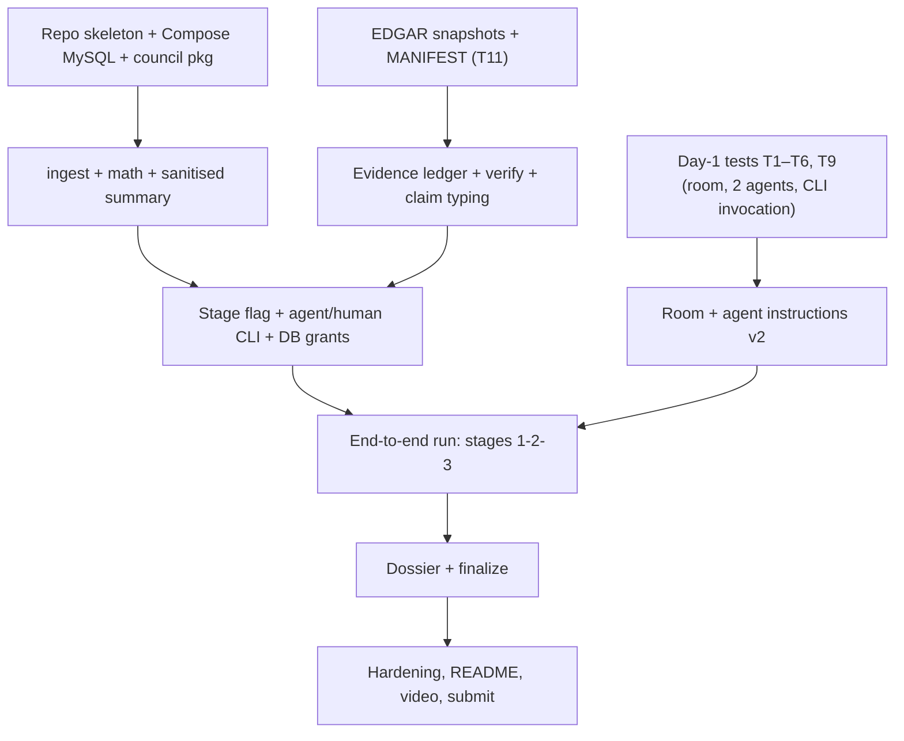

# Investor Council — Implementation Plan

Status: **v0.2, synchronised with the implemented pre-kickoff foundation (Nov 3 2026)** · Solo build · Track 02 · Window: Nov 4 (12:01 AM IST) – Nov 7 2026 (11:59 PM IST). Nov 3 = Day 0: documentation and the non-Switch foundation (section 0).

Hackathon rule: the project-specific Switch setup and workflow must be built **during** the hackathon. Before Nov 4 12:01 AM IST only these docs and the deterministic, non-Switch foundation (section 0) are committed. The room, agents and instructions are created on Day 1 or later.

### v0.2 changes
Solo schedule; two agents; no Analyst agent and no workflow engine; Day-1/2 test matrix with fallbacks; EDGAR dataset task; no price data; human stage messages; dossier rendered by Python.

---

## 0. Status on Nov 3 2026 (before kickoff)

The deterministic foundation was built before the event, as permitted: it contains no Switch room, no
Switch-connected agent configuration and no agent prompts. 197 tests pass (176 need no database, 21 run against
MySQL 8.0.46).

| Planned item | Status |
|---|---|
| Repo skeleton, Compose MySQL, `.gitignore`, `pyproject.toml` (Python `>=3.13,<3.14`) | **Done** |
| DDL, migrations, human and restricted agent accounts (`council db init`) | **Done**; grants tested against a real server |
| `council human ingest`, deterministic math, sanitised summary, `session new`, synthetic sample CSV (`samples/portfolio.csv`) | **Done** |
| EDGAR adapter: CIK lookup, company facts, filing metadata, fiscal-period identification, cache, validation, rate limiting | **Done**, synthetic fixtures only. **T11 has not been run** against real SEC responses |
| Evidence library: verification, claim typing, `GAP`, `STALE`, `CONFLICT`, human rulings | **Done** (library plus `council human rule`) |
| Dossier renderer and advice-language lint (`council human report`) | **Done** |
| One fresh-clone reproduction of the README setup (install, Compose, `council db init`, ingest, report, tests) | **Done** once, before kickoff |
| Switch room and agents, instructions, T1 to T10, `council agent …`, `advance` / `status` / `finalize`, the frozen EDGAR dataset, reset and health-check scripts, demo video, submission | **Pending** |

## 1. Priorities

| Tier | Items |
|---|---|
| **P0 — must** | Switch room + Bull/Bear agents responding to human `@mention`s; local CSV ingest + deterministic math + sanitised summary; frozen EDGAR dataset (3–5 companies) with provenance; evidence ledger with verification and claim typing; stage flag + agent/human CLI split; stage 1 → 2 → rulings → 3 flow; deterministic dossier; MySQL (Compose); sequential fallback documented; README; demo video |
| **P1 — should** | `FILING_TEXT` excerpts (quote-verified); second sample company; CLI posts the sanitised summary via Mattermost API; automated smoke test; failure-injection demo of STALE/CONFLICT/GAP |
| **P2 — could** | Frozen price snapshot (after licence check); room template import (T10); PDF export |
| **Cut** | React, FastAPI, orchestrator, third agent, live data, agent-triggered handoffs, CSV attachments, remote host |

## 2. Dependencies

Critical path: **Day-1 tests → instructions → end-to-end**. The CLI/data side is testable without Switch.

## 3. Day-1/Day-2 test matrix

Nothing essential depends on an UNVERIFIED item; each test has a fallback.

| # | Test | Pass → | Fallback | Essential? | When |
|---|---|---|---|---|---|
| T1 | One human message tagging `@bull @bear` runs both Claude Code sessions at the same time | Parallel stages | Human messages `@bull`, waits, then `@bear` (sequential); CLI still blocks `brief show --other` until stage 2 | No | D1 |
| T2 | Console-launched Claude Code honours `CLAUDE.md` in the agent directory | Tool manual in `CLAUDE.md` | Put the manual in Agent instructions | No | D1 |
| T3 | Agents run `council agent …` without approval stalls under Auto mode; whether Tools/Disallowed tools can restrict Bash | Allowlist | Rely on instructions + DB grants; synthetic data only | Partly (must run the CLI) | D1 |
| T4 | Agent can invoke the CLI by absolute path (PATH/env limits) and reads its restricted config file from its directory (Switch passes only a fixed set of env vars [Docs: onboard-your-agents]) | Works | Wrapper script in the agent directory | **Yes** | D1 |
| T5 | In stage 2 the agent reads the other's brief via `brief show --other` (not room history) | Works | Human pastes the other brief | No | D1 |
| T6 | Mattermost thread behaviour with two agents; explicit tagging; follow-ups ignored | Clear routing | Always tag both; keep follow-ups off | No | D1 |
| T7 | CSV attachment path (informational; MVP keeps CSV local) | — | n/a | **No** | optional |
| T8 | Agent→agent `@mention` (informational; not relied on) | — | n/a | **No** | optional |
| T9 | Agent attaches or posts a long markdown file back to the room | Attach dossier | Human pastes the dossier text | No | D1/D3 |
| T10 | Template import from YAML | Reproducible setup | README manual setup (~10 min) | No (P2) | D4 |
| T11 | EDGAR responses: fact field names, concept-tag variance between companies, snapshot size, declared-User-Agent behaviour | Build snapshots | Hand-curate a small subset, clearly labelled | **Yes** | D2 |

Record all outcomes in `docs/TEST_RESULTS.md` (not created yet) and update the UNVERIFIED tags in the docs. **Status on Nov 3: none of T1 to T11 has been run.** T1 to T10 need the Switch room, which may not be created before kickoff; T11 needs real SEC access with your own contact in the User-Agent.

## 4. Day-by-day (solo, ~10 focused hours/day)

### Day 0 — Nov 3 (today): docs only
- Review v0.2 docs; settle the blockers in §7. **Done** (docs approved; code and docs synchronised).
- Prepare the runtime machine without building any Switch setup: Docker running, Claude Code signed in, Switch Console installed. Choose the EDGAR contact identity (your own, not an employer's).
- **Done when:** docs approved; the foundation in section 0 is tested; the initial commit is reviewed before anything is pushed.

### Day 1 — Nov 4: Switch tests + skeleton + portfolio math
1. *Morning (time-box 3 h):* start the local server and bundled Mattermost [Docs: quickstart]; register `bull-researcher` and `bear-researcher` (own directories, Claude Code, local, Auto mode) and create the room; set `@bull` `@bear` aliases. Run T1–T6 with a stub `council agent next` script. Write `docs/TEST_RESULTS.md`.
2. *Afternoon:* **done before kickoff:** repo skeleton (layout in ARCHITECTURE §9), `docker-compose.yml` (MySQL only), `.gitignore` (`.switch/`, `.env*`, `.council.env`, every CSV except the sample, `*.local.md`, dumps, SEC cache), `pyproject.toml` (Python `>=3.13,<3.14`), DDL and both DB accounts via `council db init`.
3. **Done before kickoff:** `council human ingest` (validation, clear errors; required columns `ticker, shares, price`; optional `sector`; the price date via `--price-as-of`) and the deterministic math with unit tests; `session new` printing the sanitised summary; synthetic `samples/portfolio.csv`.

**Done when:** T1–T6 recorded; `ingest` + `session new` produce hand-verified numbers (already true); MySQL up via Compose (already true); both agents answer `@mention`s and can run a stub CLI command (pending).

### Day 2 — Nov 5: EDGAR data, evidence ledger, stage checks
1. **EDGAR dataset (T11).** Select 3–5 US-listed companies: selection criteria — financial statements with standard XBRL concepts available, at least one company sharing a sector label with the sample portfolio, one with a restatement or differing values for a period if available (to demonstrate `CONFLICT`), and one with a metric missing (to demonstrate `GAP`); if none occurs naturally, demonstrate flags with a clearly labelled test fixture. Fetch snapshots with `council human data fetch --cik N` (implemented) using a declared User-Agent (`COUNCIL_SEC_USER_AGENT`, your own contact; default 5 requests/second, never above 10; no crawling), then `council human data manifest` (URL, CIK, retrieval timestamps, SHA-256 per document; forms, accession numbers, fiscal periods and filing dates are in the facts and the evidence rows). The cache under `data/edgar/` is git-ignored by default: add the chosen dataset deliberately with `git add -f` once its SEC reuse terms are checked.
2. **Done before kickoff (library):** curated metric map (candidate XBRL concepts per metric; absent → `GAP`); evidence record and verify; claim typing/downgrade; STALE (from `config/freshness.yaml`, labelled heuristics) and CONFLICT. Concept coverage per real company is unverified until T11.
3. Pending: `submit`, `brief show --other`, `challenge add`, `final add`, stage checks, `advance`, `status`. Done before kickoff: `rule`, and DB grants applied and tested (the agent account cannot select from `portfolios`, `holdings` or `dossiers`).

**Done when:** unit tests cover typing rules, downgrade, STALE/CONFLICT/GAP (already true), stage refusals (pending) and grants (already true); both agents can file evidence/claims through the real CLI from their directories (pending).

### Day 3 — Nov 6: full run, instructions, dossier (FEATURE FREEZE at day end)
1. Write Room Instructions and Agent instructions v2 (AGENT_DESIGN §10) from the repo files in `switch/`; apply T2/T3/T4 outcomes.
2. Run the full journey: Step 0 → Stage 1 → Stage 2 → rulings → Stage 3 → dossier. Iterate on prompts until each stage completes without developer intervention.
3. `council human report` and the advice-language lint are implemented; `finalize` is pending; post the dossier to the room.
4. Measure parallel vs sequential; apply the Bull/Bear collapse criterion (AGENT_DESIGN §9).
5. Three consecutive clean runs from a reset (today: `docker compose down -v` then `council db init`; a `scripts/reset` is pending; once parallel, once sequential).
6. P1 only if time remains.

**Done when:** 3 clean runs; a human ruling visibly changes the dossier; no buy/sell/hold language; every P0 item complete. **No new features afterwards.**

### Day 4 — Nov 7: hardening, README, video, submit (target 6 PM IST; hard deadline 11:59 PM IST)
- Health check script; idempotent reset; pinned dependencies; secrets scan (no `.switch/`, `.env`, `.council.env`, no real portfolio).
- **Fresh-clone test** following the README exactly; time it (target ≤ 30 min). The setup half was verified once before kickoff; repeat it once the Switch parts exist.
- README: purpose and disclaimer (not financial advice), architecture diagram, "How Switch is used" (shared room context, instructions, human-initiated stages, addressable agents, audit trail, honest limits), privacy design and its limits, data provenance and *frozen-not-live* statement, setup, demo script.
- Demo video (check length/format with organisers): local ingest → sanitised summary → stage 1 → stage 2 challenge → human ruling → stage 3 → dossier; show a STALE/CONFLICT/GAP item; say plainly that the human triggers the stages.
- Submit; confirm receipt.

## 5. Definition of done per milestone

| Milestone | Done when | Status (Nov 3) |
|---|---|---|
| M0 Docs | Approved | **Done** (v0.2, synchronised with the code) |
| M1 Tests T1–T6 | Results recorded; each UNVERIFIED tag resolved or replaced by its fallback | Pending (needs Switch) |
| M2 Portfolio math | Unit tests green on hand-computed numbers; CSV errors are clear; sanitised summary contains only agreed fields | **Done** |
| M3 EDGAR dataset | 3–5 companies with a manifest (added deliberately with `git add -f`); every source row has URL, retrieved_at and sha256, and every evidence row has fiscal period, filing date and accession; no invented values | Adapter **done**; dataset and T11 pending |
| M4 Ledger | `FACT` requires verified evidence; downgrade, STALE, CONFLICT, GAP each tested | **Done** (library) |
| M5 Stage checks and grants | CLI refuses out-of-stage actions and `brief show --other` at stage 1; agent DB user cannot read portfolio tables | Grants **done and tested**; stage checks pending |
| M6 Agents live | One full journey in the room (parallel or sequential) without developer intervention | Pending |
| M7 Dossier | Deterministic; passes advice-language lint; shows rulings, gaps, flags, FROZEN_SNAPSHOT banner | Renderer **done**; agent sections and `finalize` pending |
| M8 Reproducibility | Fresh clone works in ≤ 30 min | Setup verified once; repeat after the Switch parts exist |
| M9 Demo | Video and submission complete | Pending |

## 6. Working across two machines
- The runtime machine is the only one that runs Switch and holds any portfolio data. The authoring machine edits code, runs unit tests (`pytest -m "not db"` needs no database) and pushes to GitHub.
- Branch per day or small trunk commits. Instruction text lives in the repo (`switch/*.md`) and is pasted into Switch; keep them in sync with a checklist.
- Never commit `.switch/`, `.env`, `.council.env` or any real portfolio (`.gitignore` already excludes them, every CSV except the sample, `*.local.md`, database dumps and the SEC cache).
- Cut line, in order: P1/P2 → parallel execution (go sequential) → filing-text excerpts → room template import → follow-up messages → merge Bull/Bear into one researcher as a last resort. Never cut: human-initiated stages, evidence labels, provenance fields, the frozen-data banner, the disclaimer.

## 7. Remaining blockers and open decisions
1. **Day-1 tests** T1–T6 and T9 (Switch behaviour) and **T11** (EDGAR responses) — unknowable until run.
2. **Company selection** for the EDGAR set and the synthetic sample portfolio — Day 2, by the criteria above.
3. **Dossier producer:** Python-only render (recommended; this is what exists) vs an agent-written narrative section.
4. **EDGAR identity:** your own contact string for the declared User-Agent.
5. **Sanitised-summary delivery:** human pastes (MVP) vs CLI posting through the Mattermost API (P1; Switch notes bot-posted messages may not count as yours — test before relying on it).
6. **Device permission:** if the authoring machine is employer-managed, confirm you may use it for this project, and keep employer code, data and credentials out of the repository.
7. **Submission details:** video length/format and any Track 02 specifics to confirm with organisers.
8. **SEC data reuse:** confirm SEC content reuse terms before committing snapshots publicly (the data is public; still cite the source and retrieval date).
