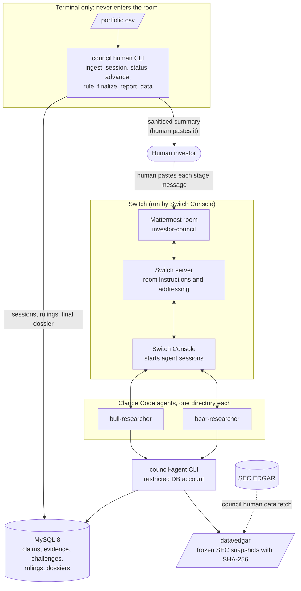
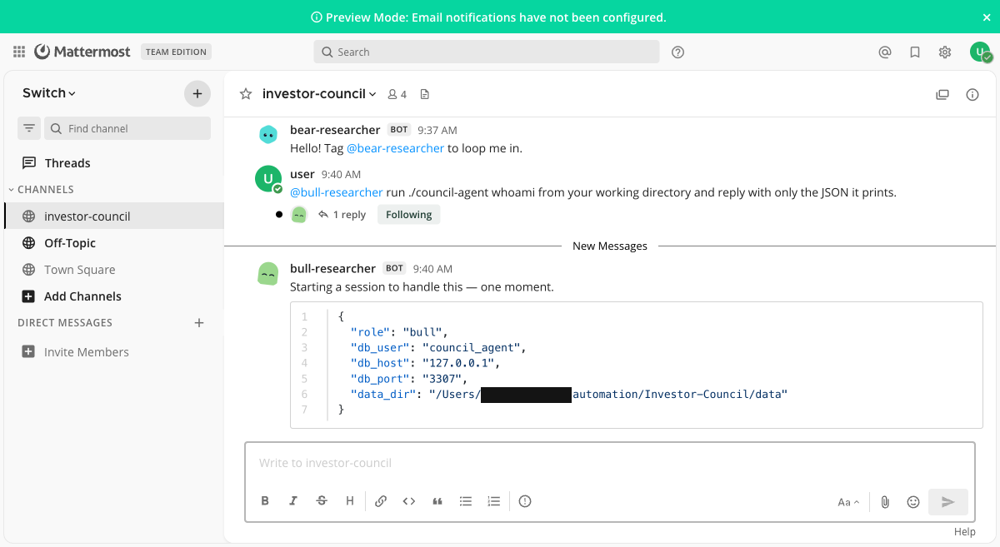
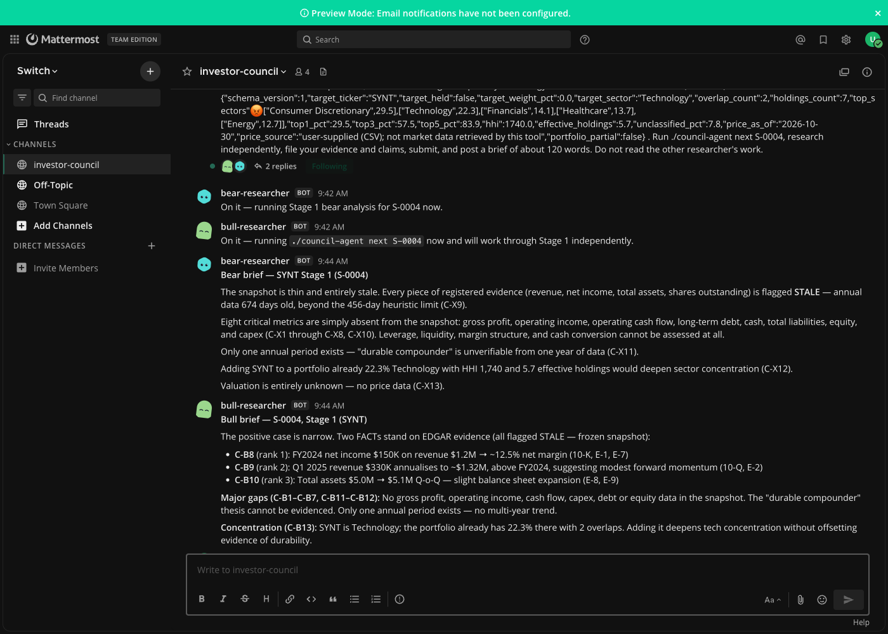
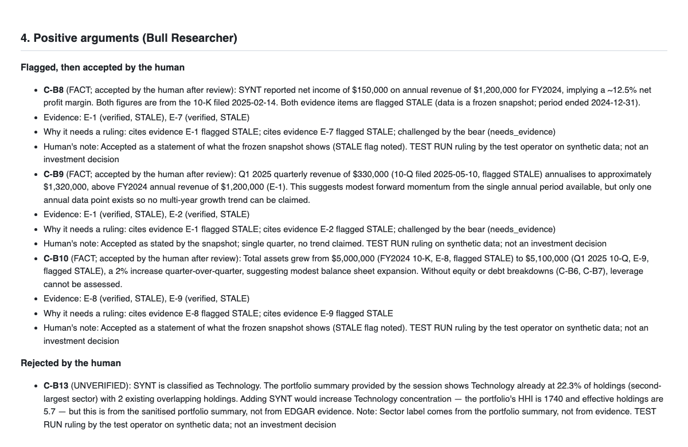
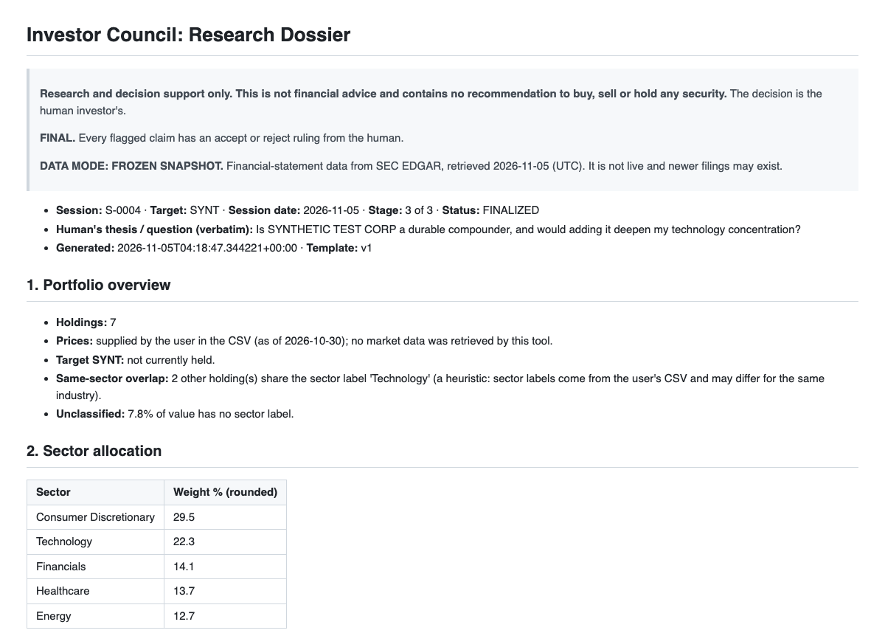

# I Built an AI Investment Council with Switch: Making Bull and Bear Researchers Work Together

*Two Claude Code agents argue about a stock in a shared Mattermost room. A Python ledger keeps them honest. A human has to settle every disputed claim. Here is how it works, what broke, and what Switch did and did not do for me.*

**Project:** [Investor Council](https://github.com/Krrish-agrawal/Investor-Council) · **Hackathon:** [WeMakeDevs × Switch "Flip the Switch"](https://www.wemakedevs.org/hackathons/switch), Track 02 (Personal or Creative Workflow) · **Solo build**

> **Research and decision support only. Not financial advice.** Investor Council never recommends buying, selling or holding anything, never touches a brokerage account and never places a trade. Every number in this post comes from a **synthetic** demo company and a **synthetic** sample portfolio. I did not run it against live SEC data (more on that below).

> **Who did what.** I designed Investor Council and built it with Claude Code as my engineering partner. The live run described below (session **S-0004**, Nov 5) was an end-to-end verification in which Claude Code played the human "test operator": it pasted the stage messages into Mattermost, ran `advance`, `rule` and `finalize`, and wrote the rulings and the decision note. I had asked it to carry out the whole workflow. The dossier labels those rulings as test-run rulings. I have not yet recorded a run in which a person makes the calls, so where this post describes human governance, it describes what the system enforces and what the test run exercised, not anyone's real investment decisions.

---

## The problem: a chatbot that agrees with you is not research

If you manage your own money and ask a single LLM "is this stock a good compounder?", three things tend to go wrong:

1. **It ignores your portfolio.** The useful question is rarely "is this a good company?" It is "what would this position do to *my* concentration and overlap?"
2. **It blends facts, guesses and persuasion into one fluent answer.** You cannot tell which sentence is a filing figure and which is a vibe, and sources are rarely shown.
3. **You are passive.** You get a verdict. You don't get to interrogate a disagreement and decide which side's claims you accept.

I wanted the opposite: two agents with different standing priors, a rule that every number must trace to a source, a visible argument between them, and a human who rules on what is allowed to stand. The output is a dossier that records *the human's* conclusion and every gap, not an agent's recommendation.

That is Investor Council. It is also, I think, a decent first project for learning Switch, because the interesting part is not the agents. It is the room they share.

## What Switch is (if you have never used it)

Switch is a way to put people and AI agents in the same chat room and have them work together. The pieces that matter for this post:

- **Switch Console** is a desktop app. On my Mac it ran a local Switch server (in Console 0.40.1 that server runs without Docker) and a bundled **Mattermost** instance (which does need Docker), and it starts a Claude Code session on my machine when one of my agents is addressed. (In Console 0.40 the agents it runs can also be moved onto a "managed machine", which is the same computer; see lesson 5.) ([Install Switch Console](https://docs.switchagents.ai/switch-rooms/getting-started/install-switch-console))
- **An agent** is a named thing with a working directory, a run location, a provider (I used Claude Code) and standing **Agent instructions**. Names and directories are fixed at creation. ([Add an agent](https://docs.switchagents.ai/switch-rooms/getting-started/add-a-second-agent), [Agent settings](https://docs.switchagents.ai/switch-rooms/getting-started/agent-settings))
- **A room** is a channel in Mattermost with **Room instructions** that every agent reads when it joins. ([Create a room](https://docs.switchagents.ai/switch-rooms/getting-started/create-a-room))
- **You `@mention` an agent** to give it work. An agent acts when someone with permission addresses it, and ignores messages that don't. ([Work in a room](https://docs.switchagents.ai/switch-rooms/using/work-in-a-room))
- **Room commands** like `!set-alias @bull-researcher @bull` handle housekeeping. ([Room commands](https://docs.switchagents.ai/switch-rooms/resources/room-commands))

One fact from the docs shaped my whole design: *follow-ups start only from a person's message, never from an agent's.* I'll come back to it, because it is why this project is a human-led council and not an autonomous swarm.

## The architecture, in one picture



*(Image version for platforms that don't render Mermaid: [docs/diagrams/architecture.png](../diagrams/architecture.png).)*

Read it from top to bottom:

- **The human** works in two places: a terminal (`council human …`) and the Mattermost room.
- **Switch** supplies the shared room, the addressable agents, the instructions every agent reads, and the audit trail of who said what.
- **The agents** do not reason over free text alone. They call a small Python CLI, `./council-agent`, which reads frozen SEC snapshots, verifies evidence and writes typed claims to **MySQL**.
- **The raw portfolio never leaves the terminal-only box.** The room sees only a sanitised summary.

The principle I kept repeating while building it: **chat carries discourse and pointers; the ledger carries structured truth.** Switch is the collaboration layer, not my orchestrator, and the database is the source of record.

## The cast

### Bull Researcher

Builds the strongest *evidence-backed* positive case. Its instructions ([role-bull.md](../../switch/role-bull.md)) tell it to work outward from the income statement ("what is working, and is it durable?"), put cash conversion first among its quality signals, and file anything the data cannot support (catalysts, market share, management quality) as an `ASSUMPTION` with a falsifier or as a `GAP`, never as a fact. Conceding is framed as a strength.

### Bear Researcher

Investigates weaknesses and risks, with a deliberately *different method*: data integrity first (gaps, stale flags, conflicting values), then leverage, earnings erosion, cash and dilution, then portfolio exposure ([role-bear.md](../../switch/role-bear.md)). The rule I care most about: **it must not manufacture negatives.** "No material contrary evidence found" is a valid, first-class result, because a Bear that always finds a catastrophe is just a different kind of cheerleader.

### The human

By design the human is not a spectator. They start every stage, decide what goes in the room, rule on every flagged claim, and own the decision field in the dossier. The system is built so that it *cannot* finish without them (in the S-0004 verification run, the test operator stood in for the human): `council human finalize` refuses while any flagged claim lacks an `accept` or `reject` ruling, with no override flag.

## Claims, evidence and the ruling gate

This is the part of the project that has nothing to do with Switch and everything to do with whether the output is trustworthy.

Every statement an agent files is a **claim** with one of four types:

| Type | Rule |
|---|---|
| `FACT` | Needs at least one evidence reference. With none, it is rejected. If the evidence is cited but doesn't verify, the claim is stored as `UNVERIFIED` with `downgraded = true`. It is never kept as a `FACT`. |
| `ASSUMPTION` | An inference or forecast. Requires a `basis` and a `falsifier` (what would prove it wrong). |
| `UNVERIFIED` | Plausible but without verified evidence. Reported separately, never under "agreed facts". |
| `GAP` | Needed data is absent. Never filled in. If an agent asks for a metric the snapshot lacks, a `GAP` claim is created automatically, naming the XBRL concepts that were tried. |

Evidence is not text the agent typed. `./council-agent evidence add S-0004 --metric revenue --basis annual` makes the CLI look up the figure in a hash-checked snapshot and record the concept, unit, period, form, filing date, accession number, source URL and retrieval time. A claimed value that doesn't match the snapshot is stored as `FAILED`, not silently corrected. Evidence also gets `STALE` or `CONFLICT` flags (a restated figure appearing in different filings) from thresholds in [config/freshness.yaml](../../config/freshness.yaml), which are labelled everywhere as *application heuristics, not accounting or regulatory standards*.

Then comes **the ruling gate**. A claim is *flagged* if it is `UNVERIFIED`, if it cites evidence that is unverified or flagged `STALE`/`CONFLICT`, or if the other agent disputed it or asked for evidence. A flagged claim is resolved only by the human's `accept` or `reject` (`needs_evidence` does not count). Until then it shows up under **UNRESOLVED** in a draft dossier, never among the findings, and `finalize` refuses. The renderer, `status` and `finalize` all call the same module ([council/report/gate.py](../../council/report/gate.py)), so they cannot disagree about what is open.

One more design choice: **the dossier body is rendered by deterministic Python, not written by an LLM.** There is nothing in it to hallucinate. Agent-written content arrives only as claims, challenges and final positions, each labelled with who filed it.

## How a session runs in Mattermost

Every stage starts with a human message. The human generates it in the terminal and pastes it into the room (in S-0004 the test operator did the pasting through browser automation):

```bash
council human session new --ticker SYNT --cik 9999999 --target-sector Technology \
  --thesis "Is SYNTHETIC TEST CORP a durable compounder, and would adding it deepen my technology concentration?"
council human message S-0004 --stage 1 --copy     # puts the stage message on the clipboard
```

### Stage 1: independent research

The message tags both agents, carries `[session S-0004]` and the sanitised portfolio summary, and tells each to run `./council-agent next S-0004`, research independently, file claims, submit, and post a ~120-word brief. In S-0004, Switch started a session for each ("Starting a session to handle this"), both replied within a minute, and they worked **concurrently**.


*The first smoke test: `@bull-researcher` was asked to run `./council-agent whoami` from its working directory. The reply shows `"role": "bull"` and `"db_user": "council_agent"`: the agent is wired to its own folder and the restricted database account.*


*Stage 1 in the `investor-council` room. The pasted message ends with the sanitised summary JSON. Below it, `bear-researcher` and `bull-researcher` post briefs citing claim codes (C-X9, C-B8…) and flagging that every registered figure is `STALE`.*

### Stage 2: the challenge round

The human runs `council human status` (are both submissions in?), then `council human advance S-0004 --to 2`, then pastes the stage-2 message. Now `./council-agent brief show --other` unlocks, but only at stage 2 and only after the agent has filed its own brief. Each agent may challenge up to three of the other's claims, restating the claim fairly first and choosing a stance: `disputes`, `partly_agrees`, `agrees` or `needs_evidence`. A `disputes` without counter-evidence is automatically converted to `needs_evidence`. One round only; the CLI refuses a second.

In S-0004 Bear filed three challenges and Bull filed two. Neither side found counter-evidence to dispute outright, and the transcript shows something I find more convincing than a staged fight: the Bear challenged Bull's "~12.5% net margin" claim by pointing out that without gross profit or operating income in the snapshot, the margin could be a below-the-line artefact, and Bull's final position *conceded* that point.

### Human rulings

`council human status` lists every flagged claim and why. A ruling is one command each. These are the actual test-operator rulings from S-0004:

```bash
council human rule S-0004 C-B8 accept --note "Accepted as a statement of what the frozen snapshot shows (STALE flag noted). TEST RUN ruling on synthetic data."
council human rule S-0004 C-B13 reject --note "TEST RUN ruling on synthetic data; not an investment decision"
```

The test operator rejected one claim: Bull's C-B13, which asserted a sector classification as if it were EDGAR evidence. Bull's final position then conceded it as "an evidentiary overreach I should not have filed." That is the loop the design is for: the human rules, the agent revises. (A real investor's rulings would of course be their own judgement. These show the mechanism, not a decision.)


*The completed dossier's argument section, rendered from the committed [`docs/examples/dossier_S-0004.md`](../examples/dossier_S-0004.md): each flagged claim shows why it needed a ruling, the evidence and its `STALE` flag, and the ruling note. This is a rendering of the Markdown file, not a Switch screenshot.*

### Stage 3: final positions and the dossier

`advance --to 3`, paste the stage-3 message, and each agent files concessions, what it still holds and what it could not establish. Then:

```bash
council human finalize S-0004 --note "your own words" -o demo_output/dossier_S-0004.md
```

The result is a ten-section Markdown dossier: portfolio overview, sector allocation, concentration, positive arguments, negative arguments, verified evidence (with accession number, filing date and source URL for every row), missing information, limitations, sources, and a decision field that the tool never fills. It carries a `FINAL` banner, a `FROZEN SNAPSHOT` banner and an advice-language lint pass. The full S-0004 dossier is committed at [docs/examples/dossier_S-0004.md](../examples/dossier_S-0004.md) (a copy of the generated `demo_output/dossier_S-0004.md`, which is git-ignored).


*The top of the FINAL dossier: the not-advice disclaimer, the `FINAL` and `FROZEN SNAPSHOT` banners, the verbatim thesis, and the sanitised portfolio overview (rounded weights only). Rendered from the Markdown file.*

What did the council actually conclude? Not much, and that is the honest result. The synthetic snapshot has one annual period and one quarter, with no gross profit, operating income, cash flow, debt or equity. Both agents ended with "could not establish a durable-compounder thesis" and a long list of `GAP` claims (eight missing metrics each). Every evidence row is flagged `STALE` (674 days against a 456-day heuristic). I'd rather ship a council that says "the data can't support this" than one that confidently fills the hole.

## The supporting pieces

### The Python CLI

Two entry points ([pyproject.toml](../../pyproject.toml)): `council` (human) and `council-agent` (agent). The split is the security boundary:

- `council human …` is what the human runs: `ingest`, `summary`, `session new`, `message`, `status`, `advance`, `rule`, `finalize`, `report`, `data fetch/register/inspect/manifest`, `agents init`.
- `./council-agent …` is what the agents run: `next`, `data show`, `evidence add`, `claim add`, `submit`, `brief show --other`, `challenge add`, `final`, `whoami`. Output is JSON. The agent's role comes **only** from its directory's `.council.env`, never from an argument, so Bull cannot pass `--as bear`.

`council human agents init` generates both agent directories: a restricted `.council.env`, a `council-agent` wrapper script and a `CLAUDE.md`. The same text is also pasted into Switch's **Agent instructions** field, so it doesn't matter whether Console-launched Claude Code loads `CLAUDE.md` on its own.

### MySQL

MySQL 8 in Docker Compose holds ten domain tables (portfolios, holdings, sessions, sources, evidence, claims, claim-evidence links, submissions, challenges, dossiers) plus a migrations table. Schema constraints do real work: unique keys allow one submission per agent per stage and one challenge per agent per target claim. The port is published on `127.0.0.1` only, and defaults to **3307** so it won't fight an existing MySQL on 3306.

### SEC EDGAR and the frozen snapshot

The adapter fetches company facts and filing metadata from `data.sec.gov`, rate-limited (default 5 requests/second, never above the SEC's 10), requires *your own* contact string as the User-Agent (there is deliberately no default), validates responses before caching, and refuses a cached file whose SHA-256 no longer matches its sidecar. Each run is labelled `FROZEN_SNAPSHOT`: data from a past retrieval date, "newer filings may exist". EDGAR is used for financial statements only, so **there is no stock-price data** and any valuation claim is a `GAP`.

## Security and portfolio-data isolation

The most sensitive thing in this project is a person's holdings. Switch's docs are clear that every agent in a room can read the room's conversation, whoever is allowed to address it ([Working safely with agents](https://docs.switchagents.ai/switch-rooms/resources/working-safely-with-agents)), and that documents in a room are available to all its members. So attaching my CSV "for a Portfolio Analyst agent" would expose it to every room member and agent, and to the model provider.

What I did instead:

1. **The CSV is parsed locally by Python** and never posted, attached or placed in an agent directory. Files with credential-like or account-number columns are refused; cost basis is ignored and never stored.
2. **Portfolio math is deterministic Python**, not an LLM: weights, sector allocation, concentration (top-1/3/5, HHI, effective holdings) and same-sector overlap. A third "Portfolio Analyst" agent would have needed the holdings, so I didn't build one.
3. **The room sees a sanitised summary:** rounded percentages, counts, the target ticker and the price date. No shares, values, cost basis, other tickers or file fingerprint.
4. **The agents' database account can't see the private tables.** `council_agent` has no `SELECT` on `portfolios`, `holdings` or `dossiers`, column-limited access on sessions and claims, and no `UPDATE` or `DELETE` anywhere ([council/db/grants.py](../../council/db/grants.py)).
5. **A leak test** derives every private value (tickers, shares, prices, market values, total) from the holdings and asserts none appears in the shareable summary or dossier, with a control proving the check can actually detect a leak. After the live run, the whole room transcript (33 posts including threads, pulled via the Mattermost API) and the FINAL dossier were checked for the seven private tickers and their numbers. None appeared.

**What this does *not* give you.** The agents run as my OS user and inherit my permissions. A Claude Code session with shell access could in principle read any file I can, including my human database credentials in `.env`. The grants, directory separation and instructions are **defence in depth, not a hard boundary**. So I demo only on a synthetic portfolio. And the sanitised summary and the thesis I type are still visible to room members and the model provider; rounded weights are still personal information.

## Implementation challenges (the real ones)

**1. Switch Console exited at launch with no window.** The shell environment exported `ELECTRON_RUN_AS_NODE`, which makes Electron apps run as plain Node and quit silently. Fix: [scripts/start_switch.sh](../../scripts/start_switch.sh) launches Console with `env -i` and a minimal, explicit environment.

**2. A corrupt installer.** The `.dmg` that had been downloaded was not a valid disk image. The official release was fetched again and its SHA-256 verified before installing.

**3. Mattermost stopped when Docker restarted and Console didn't bring it back.** Starting Docker Desktop also restarts unrelated containers, so my launch script now checks the Mattermost container and starts and health-waits it if needed, without touching anything else.

**4. A MySQL was already running on port 3306 on my machine.** Compose publishes the project's MySQL on 3307. Port conflicts were just the first of several environment gotchas; Python 3.13 is also required and pinned (`>=3.13,<3.14`), because nothing else was tested.

**5. How do agents run a CLI with a fixed environment?** The docs say agent processes get a fixed set of environment variables, so I couldn't pass database credentials through the environment. The answer is a `council-agent` wrapper in each agent's directory plus a git-ignored `.council.env` holding only the restricted account. The `whoami` screenshot above is the proof: it works, from the agent's own working directory, as `council_agent`.

**6. Independence is only partly enforceable.** Every agent in a room reads every message. I protect the blind first pass with three layers: parallel sessions, an instruction to file before reading, and a CLI that refuses `brief show --other` until stage 2. That reduces cross-contamination; it does not eliminate it, and I say so.

**7. Hallucinated numbers.** The fix is structural: a `FACT` can only cite evidence the CLI verified against a hash-checked snapshot, and the dossier is rendered by code. Agents still occasionally overreach in *framing* (Bull's rejected C-B13), which is exactly what the ruling gate exists to catch.

**8. "Stages need an agent-to-agent trigger" was the wrong design.** My first design leaned on agent-triggered handoffs, and my v0.2 rewrite removed them. The Switch docs say follow-ups start only from a person's message, and don't say what an agent mention does, so I stopped assuming it works. Making the human the trigger for every stage turned out to be a feature: it *is* the governance model.

## The limitation I have to be upfront about: manual orchestration (and what I could not verify about custom agent registration)

One more piece I wanted was a non-LLM **"Clerk"** agent that would run `advance`, `rule` and `finalize` from the room instead of the terminal, so the room would feel like a complete workflow. **I did not build it.** Here is exactly what I know and what I don't.

**What the docs say.** An agent that runs *outside* Switch Console, "built with its own client", registers with a **registration key**, and "anyone signed in to the Gateway can create a key" under **API Keys** ([People and agents](https://docs.switchagents.ai/switch-rooms/administer/people-and-agents#register-an-agent-that-runs-outside-switch-console)). Agents registered through Console are different: Console registers them with your signed-in session, so there is no key to mint ([Connectors and runtime](https://docs.switchagents.ai/switch-rooms/internals/connectors-and-runtime#registration-and-credentials)). The Gateway is the browser dashboard for a server ([glossary](https://docs.switchagents.ai/switch-rooms/resources/glossary#gateway)).

**What I checked.** On Nov 6 I looked, read-only, at the Switch Console 0.40.1 already open on my machine. Its **Admin** area has three pages: *Connectors*, *Status* and *Connector apps*. There is no API Keys page there. *Status* shows my local server running (switch-core 0.31.0, "runs without Docker"), with only the Mattermost component stopped because Docker was off. I created no key and viewed no credentials.

**What I could not verify.** I did not find the Gateway's own page on my local server, so I do not know whether **API Keys → Create Registration Key** is available there. This is therefore **a gap in what I found in Console's UI, not a demonstrated Switch platform limitation**. The docs say the capability exists. If you can reach your Gateway, try it before assuming my Clerk idea is blocked.

The one alternative I considered, a Mattermost bot account, would mean creating a new credentialed identity. The permission check in my Claude Code session denied that and I did not work around it. I have not authorised it since.

So here is what this means in practice:

- **The orchestration is manual.** The human generates three stage messages with `council human message` and pastes them into the room. `advance`, `rule` and `finalize` are terminal commands. Nothing in the room advances a stage.
- **The agents do not coordinate with each other.** They respond to each other's *filed* briefs because the human prompts them to, one round at a time, not through autonomous negotiation.
- **I have not tested whether an agent can trigger another through a mention**, and the design deliberately never depends on it.
- **Switch did not orchestrate anything.** It provided the shared room, addressable agents with their own identities and directories, and the audit trail.

I would keep rulings and finalization as human-only steps even if a Clerk were possible, because that is the point of the project.

## What I tested, and what I did not

From [docs/TEST_RESULTS.md](../../docs/TEST_RESULTS.md) (Nov 5, 2026; macOS arm64, Python 3.13.12, Docker 29.9.2, MySQL 8.0.46, Switch Console 0.40.1 with switch-core 0.31.0, Claude Code 2.1.150):

| Area | Result |
|---|---|
| Automated suite | 218 passed on Nov 5 with MySQL running (185 need no database, 33 use a real MySQL, including a scripted three-stage workflow). Re-checked Nov 6: 218 tests collected; with Docker off, 186 pass and 32 skip. The 33 MySQL tests were not re-run on Nov 6. |
| Database security | Agent account denied `SELECT` on holdings/portfolios/dossiers and any `UPDATE`/`DELETE` |
| Live Bull and Bear (S-0004) | 13 typed claims each; evidence verified; briefs posted |
| Collaboration | Parallel research; challenges filed (Bull 2, Bear 3) |
| Human governance | `finalize` refused while a claim was `needs_evidence`; accepted after the **test operator's** rulings. No run with a real person ruling is recorded |
| Privacy | No private tickers, shares, prices or values in the 33-post room transcript or the FINAL dossier |
| **Live SEC EDGAR** | **Not run.** Blocked on supplying my own contact string (an optional task I have not done yet); the adapter is validated on synthetic fixtures only, so real-response field names remain unconfirmed |
| **Human steps from the room** | **Not built.** Manual orchestration; registration-key route unverified (see above) |
| Data | One synthetic company and one synthetic portfolio. The rulings in the published dossier are labelled test-run rulings, not investment decisions |

## Reproduce it

You need: macOS (the only platform I tested), **Python 3.13**, Docker with Compose v2, a Claude Code account (`claude auth login`), and Switch Console.

```bash
git clone https://github.com/Krrish-agrawal/Investor-Council.git
cd Investor-Council

# 1. Python environment
python3.13 -m venv .venv && source .venv/bin/activate
pip install -e ".[dev]"

# 2. Secrets: no defaults on purpose. Generate your own.
cp .env.example .env
#   Set MYSQL_ROOT_PASSWORD and COUNCIL_DB_ADMIN_PASSWORD to the SAME value, plus
#   COUNCIL_DB_HUMAN_PASSWORD and COUNCIL_DB_AGENT_PASSWORD, e.g.:
#   openssl rand -base64 24 | tr -d '/+='

# 3. Database, schema, accounts, agent folders, health check
scripts/start.sh

# 4. Sanity check (database-free tests)
pytest -m "not db"
```

Then Switch, which involves a few clicks no script can do for you ([switch/SETUP.md](../../switch/SETUP.md) has the full table):

1. Install and open [Switch Console](https://docs.switchagents.ai/switch-rooms/getting-started/install-switch-console). Under **Settings → Agent providers**, Claude Code should read *Signed in*.
2. **Add a server → Run a server on this computer → Start.** The first start downloads a few GB.
3. Register `bull-researcher` and `bear-researcher`: Run location *This computer*, Directory `agents/<role>-researcher` (absolute path), provider Claude Code, **Auto mode on, Bypass permissions off**, and paste each agent's `CLAUDE.md` into **Agent instructions**.
4. Create a Mattermost room named `investor-council`, paste [switch/room-instructions.md](../../switch/room-instructions.md) into **Instructions**, add both agents, and run `!set-alias @bull-researcher @bull` (and the same for bear).
5. (macOS) `scripts/start_switch.sh` starts Console safely and waits for Mattermost.

The demo ([switch/DEMO.md](../../switch/DEMO.md), about 10 minutes, all synthetic):

```bash
.venv/bin/python scripts/seed_synthetic_snapshot.py             # offline fixture company, CIK 9999999
.venv/bin/council human data register --cik 9999999
.venv/bin/council human ingest --file samples/portfolio.csv --name demo --sample --price-as-of 2026-10-30
.venv/bin/council human session new --ticker SYNT --cik 9999999 --target-sector Technology \
    --thesis "Is SYNTHETIC TEST CORP a durable compounder, and would adding it deepen my technology concentration?"
S=S-000N                                                         # the code printed above

.venv/bin/council human message $S --stage 1 --copy              # paste into the room
.venv/bin/council human status $S                                # wait for both submissions
.venv/bin/council human advance $S --to 2
.venv/bin/council human message $S --stage 2 --copy              # paste into the room
.venv/bin/council human status $S                                # flagged claims and why
.venv/bin/council human rule $S C-B8 accept --note "..."         # accept or reject each one
.venv/bin/council human advance $S --to 3
.venv/bin/council human message $S --stage 3 --copy              # paste into the room
.venv/bin/council human finalize $S --note "your own words" -o dossier_$S.md
```

Two caveats: claim codes (like `C-B8`) depend on what your agents file, so use the ones `status` prints, and the first stage takes about two minutes. No Switch? `scripts/demo.sh --auto` runs the same flow with two headless Claude Code sessions and stand-in rulings, but it only exists as a fallback, and I did not re-run it for this post.

For real data, set `COUNCIL_SEC_USER_AGENT="Your Name you@example.com"` (your own contact, never someone else's), then `council human data fetch --cik <CIK>` and `council human data register --cik <CIK>`. As noted above, I have not run this path against the live SEC.

## Lessons learned, and advice for first-time Switch users

1. **Design for the human trigger, not against it.** Switch is built around people addressing agents. When I stopped trying to chain agents together and made each stage a human message, the architecture got simpler and the governance story got stronger.
2. **Put structure in a ledger; keep the room for discourse.** A session might not have prior room history (new session, reset, compaction), so every stage message carries `[session S-0004]` and agents re-hydrate state from `./council-agent next`. "Trust the tool over chat history" is in the agent instructions.
3. **Write Room instructions like a protocol, and Agent instructions like a role contract.** Short, numbered, with explicit "do not" lines and "report errors plainly instead of producing plausible output". The docs' guidance on [shared context](https://docs.switchagents.ai/switch-rooms/using/shared-context) is worth reading first.
4. **Choose names and directories before you create agents.** Both are fixed at creation, and re-registering means a new identity and re-inviting. I decided on `bull-researcher` and `bear-researcher` up front for that reason.
5. **Find out what keeps your agent answering.** It depends on who runs it. If Switch Console runs the agent on your computer, quitting Console stops it. If a managed machine runs it (the default on a server Console runs, since Console 0.40), quitting Console has no effect, but the machine must be on and its agent controller running. Open **Your Agents → the agent** to see which applies ([What keeps your agent running](https://docs.switchagents.ai/switch-rooms/getting-started/what-keeps-your-agent-running)). If an agent is silent, check that first, then check you addressed it by its exact name ([When an agent doesn't answer](https://docs.switchagents.ai/switch-rooms/using/agent-not-answering)). Either way, keep the machine awake during a run.
6. **Start with Auto mode on and Bypass off.** In S-0004 the agents ran `./council-agent` without an approval stall. If an approval does appear it may be in a thread, not the main channel.
7. **Tag every agent explicitly, every time.** An `@` always wins, and a message without one reaches no agent unless the server has follow-ups on. Follow-ups reach "the agent that last spoke, or was last tagged, in the thread", which is ambiguous with two agents, so every stage message in this project tags both agents by name. (`!follow-ups off` turns them off per room.)
8. **Assume everything in a room is visible to every agent.** Decide what to share before you paste, not after. This one decision (no CSV in the room) shaped half of my architecture.
9. **Test the undocumented stuff early.** I wrote down every assumption (does `CLAUDE.md` load? do two sessions run at once?) as a numbered test and ran them against the real app (all but the live-SEC one). Writing the fallback beside each assumption meant a failed test cost me a paragraph of docs, not a redesign.
10. **Write limitations down as you hit them, and re-check them before you publish.** The Clerk gap is in my test results from the day it happened, and my first note called it "blocked". Re-reading the docs and the Console showed the accurate statement is narrower: not found in Console's UI, unverified in the Gateway. A limitation you haven't re-checked is a claim you can't back up.

## Closing

What Switch gave me, concretely: a shared room the human and both agents could see, addressable agents with their own identities and directories, a way to interject at any moment, and an audit trail. What it did not give me: orchestration. The stage control and rulings live in my own CLI, and I kept the human steps manual on purpose, because the thing I wanted was not a pipeline of agents but a disciplined argument that a person gets to settle. The one piece of automation I wanted, a room-side Clerk agent, I did not build.

If you want to try it, the repo is at [github.com/Krrish-agrawal/Investor-Council](https://github.com/Krrish-agrawal/Investor-Council). If you build something similar, I'd love to hear whether you can reach your Gateway's API Keys page on a local server and register an external agent. That's the piece that would turn my manual council into one that runs from the room.

*Investor Council is a research tool, not an adviser. Nothing in this post or the project is a recommendation to buy, sell or hold any security.*

---

### Further reading

- [Switch Rooms: quickstart and getting started](https://docs.switchagents.ai/switch-rooms/getting-started/index)
- [How Switch works](https://docs.switchagents.ai/switch-rooms/using/how-switch-works) and [Life of a message](https://docs.switchagents.ai/switch-rooms/internals/life-of-a-message)
- [Identity and access](https://docs.switchagents.ai/switch-rooms/internals/identity-and-access) and [Working safely with agents](https://docs.switchagents.ai/switch-rooms/resources/working-safely-with-agents)
- [What keeps your agent running](https://docs.switchagents.ai/switch-rooms/getting-started/what-keeps-your-agent-running)
- [SEC EDGAR APIs and fair-access policy](https://www.sec.gov/os/accessing-edgar-data)
- Project docs: [ARCHITECTURE](../ARCHITECTURE.md) · [AGENT_DESIGN](../AGENT_DESIGN.md) · [TECHNICAL_RISKS](../TECHNICAL_RISKS.md) · [TEST_RESULTS](../TEST_RESULTS.md)
